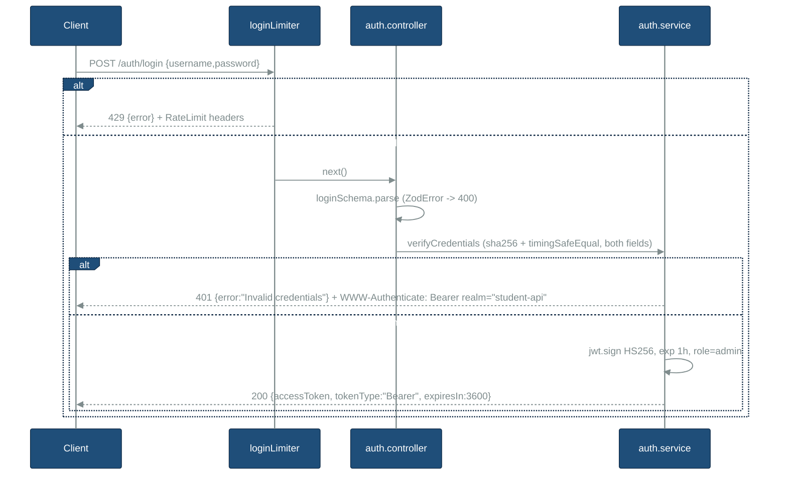
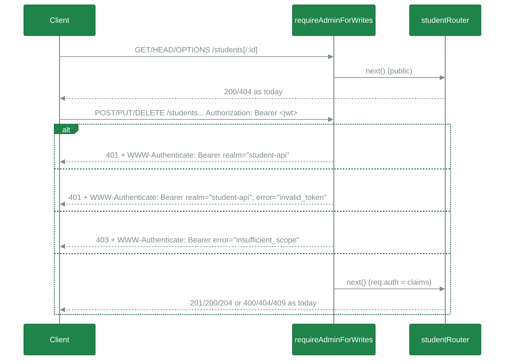

# Architecture notes: authentication (JWT login + admin-only writes)

Status: design proposal. Binding input: `agents/TEMP/authentication/coding-flow-state.md`. No code changed.

## TLDR

- Pick **Option B**: global "safe-method" guard. GET/HEAD/OPTIONS are public. Every other method needs a valid admin JWT. Exception: routers mounted before the guard (`/auth`).
- New `src/auth/*` module. It follows the `students` layout: routes, controller, service, schema, middleware, types.
- Libraries: `jsonwebtoken@^9.0.3` (HS256 pinned) and `express-rate-limit@^8.7.1`. Tests: `vitest` and `supertest`.
- `createApp(options?)` takes an optional `auth` config so tests can inject it. Build the rate limiter inside `createApp` so each app has its own counter.
- Credential check: SHA-256 both sides, then `crypto.timingSafeEqual`. Check username AND password every time (no short-circuit). Same 401 for every failure.
- Discovery: a malformed JSON body currently returns 500 and `console.error` logs the raw body, so a login password can reach the logs. Fix this in `errorHandler`.

## Existing code (evidence)

| Fact | Evidence |
|---|---|
| `createApp()` builds the app: json 1mb, `/health`, `/students`, 404, errorHandler | [src/app.ts](../../../src/app.ts#L7-L26) |
| `/health` uses the global `pool` directly | [src/app.ts](../../../src/app.ts#L13-L19) |
| Config is read at import time and throws on bad values | [src/config.ts](../../../src/config.ts#L14-L29) |
| `pool` imports `config`, so importing it triggers config validation | [src/db/pool.ts](../../../src/db/pool.ts#L1-L9) |
| `AppError(statusCode, message, details?)` | [src/errors/AppError.ts](../../../src/errors/AppError.ts#L1-L11) |
| errorHandler: ZodError → 400, AppError → status, else `console.error(error)` + 500. It sets no headers. | [src/middleware/errorHandler.ts](../../../src/middleware/errorHandler.ts#L9-L33) |
| `asyncHandler` sends rejections to `next` | [src/middleware/asyncHandler.ts](../../../src/middleware/asyncHandler.ts#L3-L9) |
| Student routes: GET /, GET /:id, POST /, PUT /:id, DELETE /:id | [src/students/student.routes.ts](../../../src/students/student.routes.ts#L7-L11) |
| Controllers validate with `schema.parse(...)` (zod, `.strict()`) | [src/students/student.controller.ts](../../../src/students/student.controller.ts#L10-L14), [src/students/student.schema.ts](../../../src/students/student.schema.ts#L11-L18) |
| `index.ts` calls `createApp()` after `ensureSchema()` | [src/index.ts](../../../src/index.ts#L24) |
| CommonJS output, `moduleResolution: node` | [tsconfig.json](../../../tsconfig.json#L4-L5) |
| `engines.node >=18`; deps: express 4, zod 3, pg, dotenv | [package.json](../../../package.json#L16-L24) |
| Installed: Node v24.21.0, express 4.22.3, zod 3.25.76 | local `node --version` + `node_modules/*/package.json` |
| `.env.example` has only PORT and DATABASE_URL | `.env.example` L1-L2 |

## Options

All three options share the same auth core: login route, credential check, JWT sign/verify, rate limiter, and a `requireAdmin` middleware. The options differ only in **where** the code enforces auth.

### Option A: per-route middleware

`studentRouter.post("/", requireAdmin, ...)` on each write route.

- Pros: explicit. Easy to read. Standard Express idiom. Each route shows its policy.
- Cons: **fail-open**. If a developer forgets the middleware on a new write route, the route is public. Policy is spread across files. You need one test per route to prove it.

### Option B: global safe-method guard (chosen)

In `app.ts`: mount `/health` and `/auth` first, then `app.use(requireAdminForWrites)`, then `/students`. The guard calls `next()` for GET/HEAD/OPTIONS. For other methods it runs `requireAdmin`.

- Pros: **fail-safe default**. Any new write route is protected automatically. One place states the policy, and it maps 1:1 to the requirement ("only admins change data, all GETs public"). `student.routes.ts` does not change. One test matrix covers the policy.
- Cons: the policy depends on mount order (`/auth` must come before the guard). A test pins the order. A non-GET request to an unknown path gets 401, not 404. This is acceptable because it hides route existence. A future public write route (for example a webhook) must mount before the guard, and that mount must be explicit.

### Option C: router-level split

Two routers: `publicStudentRouter` (GETs) and `adminStudentRouter` with `router.use(requireAdmin)`.

- Pros: groups the policy by router. Fail-safe inside the admin router.
- Cons: splits one resource across two routers. A developer can still add a write route to the public router (fail-open). It needs more churn in `students/*` than A or B.

### Scoring (reasoning: DECIDE)

| Criterion | A | B | C |
|---|---|---|---|
| Fail-safe for new writes | ✗ | ✓ | partial |
| Diff size / KISS | small | smallest | medium |
| Matches requirement wording | indirect | direct | indirect |
| Testability | per route | one matrix | per router |
| Risk | forgotten guard | mount order | wrong router |

- A pruned: fail-open on new write routes.
- C pruned: dominated by B (more churn, still fail-open on the public router).
- **B chosen. Confidence 0.85.** Caveat: the mount-order dependency. Mitigation: comment in `app.ts` and a test (`POST /auth/login` reachable without token; `POST /students` → 401).

## Library choices

### JWT

| Lib | Version (verified on npm registry) | Pros | Cons |
|---|---|---|---|
| `jsonwebtoken` | 9.0.3 (+ `@types/jsonwebtoken` 9.0.10) | CJS, works with the current tsconfig. Sync API. Widely used. `verify(..., { algorithms: ["HS256"] })` pins the algorithm. v9 hardened `none` handling. | Heavier dependency tree (lodash.*, jws, semver). Older API style. |
| `jose` | 6.2.12 | Modern, zero dependencies, strict by default, typed. | v6 `exports` has only `default` (ESM) entries. This needs `require(esm)` (Node ≥20.19/22.12) and likely `moduleResolution: node16/bundler` for types. That breaks `engines >=18` and needs a tsconfig change. Async API. |
| `node:crypto` hand-rolled | built-in | No dependency. | Must hand-roll base64url, header check, alg pinning, exp/nbf, and constant-time signature compare. High risk of a security bug. Violates "don't roll your own crypto". |

**Pick: `jsonwebtoken@^9.0.3`.** Lowest integration risk with CJS + `moduleResolution: node`. Pin the algorithm on both sign and verify.

Usage:
- sign: `jwt.sign({ role: "admin" }, secret, { algorithm: "HS256", expiresIn: 3600, subject: "admin", issuer: "student-api", audience: "student-api" })`
- verify: `jwt.verify(token, secret, { algorithms: ["HS256"], issuer: "student-api", audience: "student-api" })`, then check `payload.role === "admin"`.
- `exp` is checked by default. `algorithms: ["HS256"]` rejects `none` and RS/HS confusion.

### Rate limit

| Option | Pros | Cons |
|---|---|---|
| `express-rate-limit` 8.7.1 (CJS + ESM, peer `express >=4.11`, verified) | Mature. Sends standard `RateLimit-*` headers. Validates `trust proxy` misconfig at runtime. Handles IPv6 subnet keying. | One dependency. In-memory store is per process. |
| Custom Map-based limiter | No dependency. | Must re-implement window expiry, memory cleanup, headers, IPv6 normalization. Easy to get wrong. |

**Pick: `express-rate-limit@^8.7.1`.** Options: `windowMs: 15*60*1000`, `limit: 5`, `standardHeaders: "draft-8"`, `legacyHeaders: false`, and a `handler` that sends a JSON 429 that matches the errorHandler shape.

Trust proxy:
- Today `trust proxy` is unset, so `req.ip` is the socket address. This is correct for direct exposure.
- Behind a reverse proxy, all clients share one bucket. An attacker can then lock out the admin (DoS).
- Never use `trust proxy: true`: clients can spoof `X-Forwarded-For`. Use a hop count or proxy IP list only when you deploy behind a proxy (see Q3).
- Single-process memory store: counters reset on restart and are not shared across instances. Accepted (KISS).

### Tests

| Package | Verified latest | Note |
|---|---|---|
| `vitest` | 5.0.4: `engines.node ^22.12.0 \|\| ^24 \|\| >=26`. Peer `vite` is required. | Conflicts with `engines >=18`. 3.2.4 supports Node 18. See Q1. |
| `supertest` | 7.3.1 | — |
| `@types/supertest` | 7.2.1 | — |

## File layout

```
src/
  auth/
    auth.routes.ts       createAuthRouter(authConfig): POST /login + login limiter
    auth.controller.ts   login handler: zod parse -> service -> { accessToken, tokenType, expiresIn }
    auth.service.ts      verifyCredentials (timing-safe), issueToken, verifyToken
    auth.schema.ts       loginSchema (zod, strict)
    auth.middleware.ts   requireAdmin(authConfig), requireAdminForWrites(authConfig)
    auth.types.ts        AuthConfig, AdminClaims
tests/
  auth.login.test.ts
  auth.guard.test.ts
vitest.config.ts
```

### Files to add or change

| File | Change |
|---|---|
| `src/config.ts` | Add `readAuth()` → `config.auth = { adminUsername, adminPassword, jwtSecret }`. Throw if a value is missing or empty, or if `jwtSecret.length < 32`. Error messages name the key and never include the value. |
| `src/app.ts` | Change signature to `createApp(options: { auth?: AuthConfig } = {})` with default `config.auth`. Mount order: `/health` → `/auth` → `requireAdminForWrites` → `/students` → 404 → errorHandler. |
| `src/middleware/errorHandler.ts` | Map body-parser errors (`type === "entity.parse.failed"` / `status` 4xx) to 400 `{ error: "Invalid JSON body" }`, with no logging. |
| `src/auth/*` | New (above). |
| `.env.example` | Add `ADMIN_USERNAME=`, `ADMIN_PASSWORD=`, `JWT_SECRET=` (placeholders only). |
| `package.json` | Add deps. Add `"test": "vitest run"`. Possibly change `engines` (Q1). |
| `vitest.config.ts` | `test.env` with dummy `DATABASE_URL`, `ADMIN_*`, `JWT_SECRET` (test-only values) so `config` import passes. `pg.Pool` connects lazily, so no DB is needed. |

### Testability

- `config` validates at import (`pool` → `config`). Tests set env in `vitest.config.ts` `test.env`.
- Inject auth via `createApp({ auth })`. Tests can then use a known secret to mint expired, wrong-alg, wrong-role, or `none` tokens.
- Student writes: use `vi.mock("../src/students/student.repository")` so guard tests need no Postgres. `/health` tests mock `../src/db/pool`.
- Build the limiter inside `createAuthRouter`, so each `createApp()` has a fresh counter and tests stay isolated.

## Dependencies

| Package | Range | Type |
|---|---|---|
| jsonwebtoken | ^9.0.3 | dep |
| express-rate-limit | ^8.7.1 | dep |
| @types/jsonwebtoken | ^9.0.10 | dev |
| vitest | ^5.0.4 (if Q1 = yes) else ^3.2.4 | dev |
| supertest | ^7.3.1 | dev |
| @types/supertest | ^7.2.1 | dev |

No change to express, zod, pg, or dotenv.

## Request flows





`/health` is mounted before the guard and is unchanged.

## Error / status matrix

| Case | Status | Body `error` | Header |
|---|---|---|---|
| Login body invalid (zod) | 400 | "Validation failed" + details | — |
| Malformed JSON (any route) | 400 | "Invalid JSON body" | — |
| Login wrong username or password | 401 | "Invalid credentials" (identical for both) | `WWW-Authenticate: Bearer realm="student-api"` |
| Login over limit | 429 | "Too many login attempts, try again later" | `RateLimit`, `RateLimit-Policy`, `Retry-After` |
| Write, no/!Bearer Authorization | 401 | "Authentication required" | `WWW-Authenticate: Bearer realm="student-api"` |
| Write, bad sig / alg / expired / malformed | 401 | "Invalid or expired token" (one message for all) | `... error="invalid_token"` |
| Write, valid token, role ≠ admin | 403 | "Forbidden" | `... error="insufficient_scope"` |
| Write, valid admin | as today | as today | — |
| GET /health, GET /students[/:id] | as today | as today | — |
| Missing / short auth env at startup | process exits 1 | message names the key only | — |

Implementation: `requireAdmin` calls `res.setHeader("WWW-Authenticate", ...)` and then `next(new AppError(401|403, msg))`. errorHandler keeps its shape. No change to `AppError` is needed.

## Security notes (OWASP Top 10 2021)

| Risk | Mitigation |
|---|---|
| A01 Broken Access Control | Fail-safe global guard (B). Deny by default for non-safe methods. Role claim checked. Test matrix covers every method × auth state. |
| A02 Cryptographic Failures | HS256 pinned. Secret ≥32 chars, enforced at startup. Recommend a random secret (`crypto.randomBytes(48).toString("base64url")`). Token has no secrets: `sub:"admin"`, not the username. Use HTTPS in deployment (out of scope here). |
| A04 Insecure Design | One role, no refresh, 1h exp (YAGNI). Accepted: no revocation. Rotating `JWT_SECRET` invalidates all tokens. |
| A05 Security Misconfiguration | Startup fails fast. `x-powered-by` is already disabled ([src/app.ts](../../../src/app.ts#L10)). No `trust proxy: true`. `.env` stays git-ignored. `.env.example` has placeholders only. |
| A07 Identification & Auth Failures | Timing-safe compare of fixed-length digests. Both fields always compared (`&`, not `&&`). One generic 401 message (no enumeration). Rate limit 5/15min/IP. Login body max lengths (for example 256). |
| A08 Integrity Failures | `algorithms: ["HS256"]` blocks `none` and alg confusion. Verify `iss`/`aud`/`exp`. |
| A09 Logging Failures | Never log `Authorization`, the token, the request body, or `ADMIN_*`/`JWT_SECRET`. Fix the body-parser `err.body` leak via `console.error` ([src/middleware/errorHandler.ts](../../../src/middleware/errorHandler.ts#L31)). Map all jwt errors to one generic message (no "invalid signature" vs "jwt expired" oracle). |
| A03 Injection / A10 SSRF | No new SQL or outbound calls. zod strict schema on login. |
| A06 Vulnerable Components | Pin caret ranges. Run `npm audit` in CI. Prefer the maintained `jsonwebtoken@9`. |

Accepted risk: `ADMIN_PASSWORD` strength is not enforced. The user decision only requires a `JWT_SECRET` length check.

## Open questions (max 5; recommended answer first)

1. Change `engines.node` to `>=22.12` so you can use `vitest@5`? **Rec: yes.** Node 18 and 20 are EOL. Local Node is 24. Otherwise use `vitest@^3.2.4`.
2. Should the 5/15min limit count only failed logins (`skipSuccessfulRequests: true`)? **Rec: yes.** The admin does not lock out himself, and an attacker still gets 5 tries.
3. Will the API run behind a reverse proxy? **Rec: no for now.** Leave `trust proxy` unset. Add a `TRUST_PROXY` hop count later if needed.
4. JWT `sub`: fixed `"admin"` or `ADMIN_USERNAME`? **Rec: `"admin"`.** It does not expose the username in a readable token.
5. Include the malformed-JSON fix (400, no body logging) in this feature? **Rec: yes.** Without it, login passwords can reach the logs.

## Verification status

- Verified on the npm registry (registry.npmjs.org/*/latest): versions of jsonwebtoken 9.0.3, @types/jsonwebtoken 9.0.10, jose 6.2.12 (ESM-only `exports`), express-rate-limit 8.7.1 (CJS+ESM, peer express ≥4.11), vitest 5.0.4 (engines ^22.12 / ^24 / ≥26), vitest 3.2.4 (Node 18+), supertest 7.3.1, @types/supertest 7.2.1.
- Not verified on the web (from known library behavior; confirm during implementation): jsonwebtoken `verify` option names and v9 `none` handling; express-rate-limit v8 option names (`limit`, `standardHeaders: "draft-8"`, `skipSuccessfulRequests`, `handler`) and trust-proxy validation errors; body-parser `err.type === "entity.parse.failed"` and `err.body`; whether jose 6 has a `main` field for `moduleResolution: node`.
